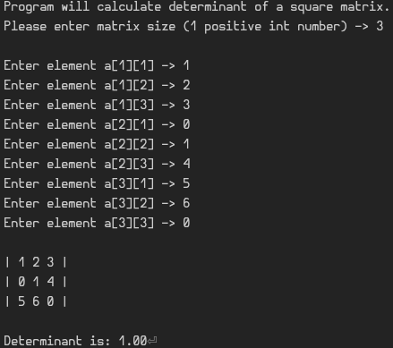

# Matrix and vector implementation demo

This simple CLI program implements a matrix class and a vector class, and showcases their methods.

### What it do

### Why did I make this

Learning basic C++ programming and math in general.