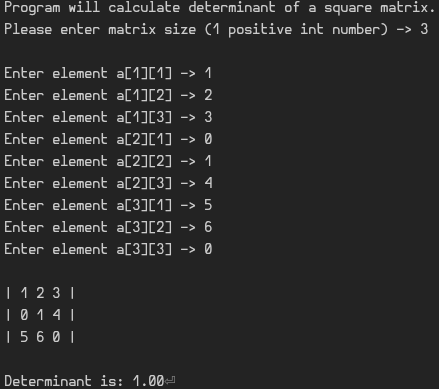

# Matrix Determinant Calculator

This simple CLI program implements a function that accepts a 2-dimensional vector of numbers as a mathematical square matrix, and returns its determinant value.

### What it do

### Why did I make this

Learning basic C++ programming and math in general.