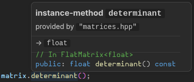

# Matrix Determinant Calculator

This simple CLI program implements a function that accepts a 2-dimensional vector of numbers as a mathematical square matrix, and returns its determinant value.

### What it do

### Why did I make this

Learning basic C++ programming and math in general.

### How it works

The most important part is the custom **FlatMatrix** class, with all the necessary functions, including the **determinant()** function. I tried to make this class accept any floating-point data type (int could potentially cause problems, example: since matrix of int can be inverted and be no longer int)

